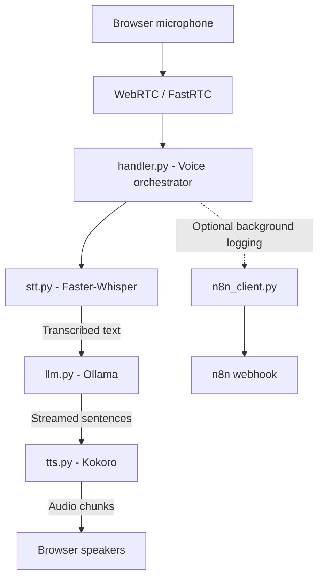

# Local Real-Time Voice Agent

A local-first, real-time voice assistant built with **Python, WebRTC, Faster-Whisper, Ollama, and Kokoro TTS**.

Speak through your browser microphone and receive spoken responses. The pipeline transcribes your speech, streams a response from a locally hosted language model, and starts generating speech sentence by sentence. It also supports interruption handling and optional background conversation logging through an n8n webhook.

> **Designed for local development:** Speech recognition, language generation, and speech synthesis can run on your own machine. The optional n8n webhook sends conversation data to the endpoint you configure.

---

## Features

- **Browser-based microphone input** using WebRTC and FastRTC.
- **Speech-to-text** with Faster-Whisper.
- **Local LLM responses** streamed from Ollama.
- **Text-to-speech** using Kokoro.
- **Sentence-level audio streaming** so speech can begin before the full response is generated.
- **Interruption support** through FastRTC's interrupt handling.
- **Optional n8n logging** dispatched in a background thread to avoid blocking the voice pipeline.
- **FastAPI health endpoint** for backend checks and custom frontend integrations.

## How It Works

When the user finishes a speech segment, the application processes it through the following pipeline:



### Pipeline stages

1. **Audio capture** — The browser captures microphone audio and sends it through WebRTC/FastRTC.
2. **Voice turn detection** — `handler.py` receives the completed audio segment when the user pauses.
3. **Speech recognition** — `stt.py` converts the audio to the format expected by Faster-Whisper and transcribes it.
4. **Response generation** — `llm.py` sends the transcription to Ollama and streams generated text.
5. **Sentence splitting** — Complete sentences are yielded as soon as possible instead of waiting for the entire response.
6. **Speech synthesis** — `tts.py` converts each sentence into audio for playback.
7. **Optional logging** — `n8n_client.py` sends the user prompt and assistant response to the configured webhook in a background thread.

## Technology Stack

| Component | Technology | Purpose |
|---|---|---|
| Browser audio | WebRTC / FastRTC | Captures and streams microphone audio |
| Backend | Python / FastAPI | Application and API server |
| Speech-to-text | Faster-Whisper | Converts speech into text |
| Language model | Ollama | Runs the local chat model |
| Text-to-speech | Kokoro TTS | Converts response text into speech |
| Automation | n8n (optional) | Receives conversation logs through a webhook |

## Project Structure

```text
Voice-Agent-WebRTC-Service/
│
├── main.py                      # Application entry point
├── requirements.txt             # Python dependencies
├── config/
│   └── settings.py              # Model names, URLs, and environment settings
│
└── src/
    ├── server.py                # FastAPI setup, CORS, and health route
    │
    ├── webrtc/
    │   └── handler.py            # Voice pipeline orchestration
    │
    ├── pipeline/
    │   ├── stt.py                # Faster-Whisper speech recognition
    │   ├── llm.py                # Ollama streaming and sentence splitting
    │   └── tts.py                # Kokoro speech generation
    │
    └── automation/
        └── n8n_client.py         # Optional background webhook sender
```

## Getting Started

### 1. Prerequisites

Make sure the following are installed:

- **Python 3.10 or later**
- **Git**
- **Ollama** — installed and running locally
- A supported browser with microphone access

Download Ollama from [ollama.com](https://ollama.com/).

Pull the example language model:

```bash
ollama pull llama3.2
```

Make sure the Ollama service is running before starting the application. The default local API address is `http://localhost:11434`.

### 2. Clone the repository

```bash
git clone https://github.com/bibekpx/Voice-Agent-WebRTC-Service.git
cd Voice-Agent-WebRTC-Service
```

### 3. Create and activate a virtual environment

**Windows (Command Prompt):**

```bat
python -m venv .venv
.venv\Scripts\activate
```

**Windows (PowerShell):**

```powershell
python -m venv .venv
.venv\Scripts\Activate.ps1
```

**Linux / macOS:**

```bash
python3 -m venv .venv
source .venv/bin/activate
```

### 4. Install dependencies

```bash
python -m pip install --upgrade pip
pip install -r requirements.txt
```

### 5. Configure the application

Review `config/settings.py` and set the values for your local environment. Use a `.env` file only if your settings implementation is configured to read one.

| Setting | Example | Description |
|---|---|---|
| `WHISPER_MODEL_SIZE` | `base.en` | Faster-Whisper model size. Other examples include `tiny.en` and `small.en`. |
| `OLLAMA_BASE_URL` | `http://localhost:11434` | Address of the local Ollama API. |
| `OLLAMA_MODEL` | `llama3.2` | Model name available in Ollama. |
| `N8N_WEBHOOK_URL` | Empty string | Optional n8n webhook URL. Leave empty to disable webhook logging. |

The values above are examples. Use the setting names and defaults defined by the current application code.

### 6. Run the application

Choose one of the following modes.

#### Option A: Browser test interface

Recommended for local development:

```bash
python main.py
```

Open the interface in your browser:

```text
http://localhost:7860
```

Allow microphone access when prompted, then start speaking.

#### Option B: FastAPI backend

Use this mode when connecting a custom React, Next.js, or other frontend:

```bash
uvicorn main:app --host 0.0.0.0 --port 8000 --reload
```

Health endpoint:

```text
GET http://localhost:8000/health
```

> Run the command that matches the application entry point and exported FastAPI object in your checkout. The backend command assumes `main.py` exposes an `app` object.

---

## Where to Make Changes

| To change... | File | Main function / area |
|---|---|---|
| Assistant personality or system prompt | `src/pipeline/llm.py` | `generate_sentence_stream()` |
| Whisper model or compute device | `src/pipeline/stt.py` | `STTService.__init__()` |
| TTS voice or synthesis settings | `src/pipeline/tts.py` | `stream_audio()` |
| FastAPI routes | `src/server.py` | `create_app()` |
| n8n webhook payload | `src/automation/n8n_client.py` | `_send_webhook_sync()` |
| Voice interruption behavior | `src/webrtc/handler.py` | `create_stream()` and `ReplyOnPause(...)` |

### Switching Whisper to CUDA

The current configuration is described as CPU `int8`. To try GPU inference, review the Faster-Whisper/CTranslate2 CUDA requirements for your environment, then update the model initialization in `src/pipeline/stt.py` (for example, the device and compute type). Do not switch to CUDA unless the required NVIDIA drivers and CUDA libraries are installed and compatible.

---

## Function Call Flow

The main voice-turn flow is coordinated by `VoicePipelineOrchestrator.handle_voice_turn(audio)` in `src/webrtc/handler.py`.

```text
VoicePipelineOrchestrator.handle_voice_turn(audio)
    │
    ├── STTService.transcribe(audio_data, sample_rate)
    │      └── Returns the recognized user text
    │
    ├── LLMService.generate_sentence_stream(user_prompt)
    │      └── Streams generated text and yields complete sentences
    │
    ├── TTSService.stream_audio(sentence)
    │      └── Produces audio for each sentence
    │
    └── trigger_n8n_flow(user_prompt, full_reply)   [optional]
           └── Sends the log in a background thread
```

### Audio processing in STT

The STT stage is responsible for preparing the captured audio before transcription. Depending on the incoming audio format, the processing described by the project includes:

- Converting stereo audio to mono.
- Normalizing `int16` samples to `float32` when required.
- Resampling audio to 16 kHz when the input sample rate differs.
- Passing the prepared audio to Faster-Whisper.

### Streaming response and speech

`llm.py` consumes the Ollama streaming response and groups generated text into complete sentences. `tts.py` can then synthesize each yielded sentence while the LLM continues generating the rest of the response. This reduces the wait before the first spoken response compared with generating the full answer before starting TTS.

---

## Performance and Development Notes

Keep these guidelines in mind when extending the pipeline:

1. **Do not block the audio loop.** Database operations, webhook calls, and other slow I/O should run outside the real-time processing path. The n8n integration uses a background thread for this reason.
2. **Preserve contiguous NumPy arrays where required.** Keep `np.ascontiguousarray()` in the STT/TTS processing paths when the downstream library expects contiguous memory. Removing it can cause compatibility or performance problems.
3. **Keep spoken output clean.** Avoid Markdown formatting, emoji, and decorative symbols in the LLM system prompt when the response will be read aloud. Otherwise, the TTS engine may attempt to speak those symbols or formatting cues.
4. **Stream incrementally.** Yield complete sentences as they become available rather than waiting for the entire LLM response.
5. **Keep optional integrations optional.** The voice pipeline should continue to work when `N8N_WEBHOOK_URL` is not configured.

## Troubleshooting

### Ollama connection error

- Confirm Ollama is installed and running.
- Check that `OLLAMA_BASE_URL` points to the correct local API address.
- Confirm the configured model is available:

  ```bash
  ollama list
  ```

- Pull the model if it is missing:

  ```bash
  ollama pull llama3.2
  ```

### Microphone is not available

- Allow microphone access in your browser.
- Check that the correct input device is selected in your operating system and browser.
- Close other applications that may be using the microphone.
- Try the local interface at `http://localhost:7860`.

### Model startup or dependency errors

- Activate the project's virtual environment.
- Reinstall dependencies from `requirements.txt`.
- Confirm that your Python version meets the project's requirement.
- Check the terminal output for the first underlying exception; later errors may be a consequence of that initial failure.

### n8n logs are not received

- Confirm that `N8N_WEBHOOK_URL` is configured correctly.
- Verify that the n8n workflow is active and its webhook path is correct.
- Check the application logs for webhook connection or response errors.
- Leave the setting empty to run without n8n logging.

---

## Contributing

Contributions and improvements are welcome. Before submitting changes:

1. Keep the real-time audio path responsive.
2. Test the affected STT, LLM, or TTS stage independently where possible.
3. Verify that the browser interface and health endpoint still start correctly.
4. Avoid committing local model files, virtual environments, secrets, or machine-specific configuration.

## License

Add the repository's license information here once a license has been selected and committed.

---

**Repository:** [Voice-Agent-WebRTC-Service](https://github.com/bibekpx/Voice-Agent-WebRTC-Service)
